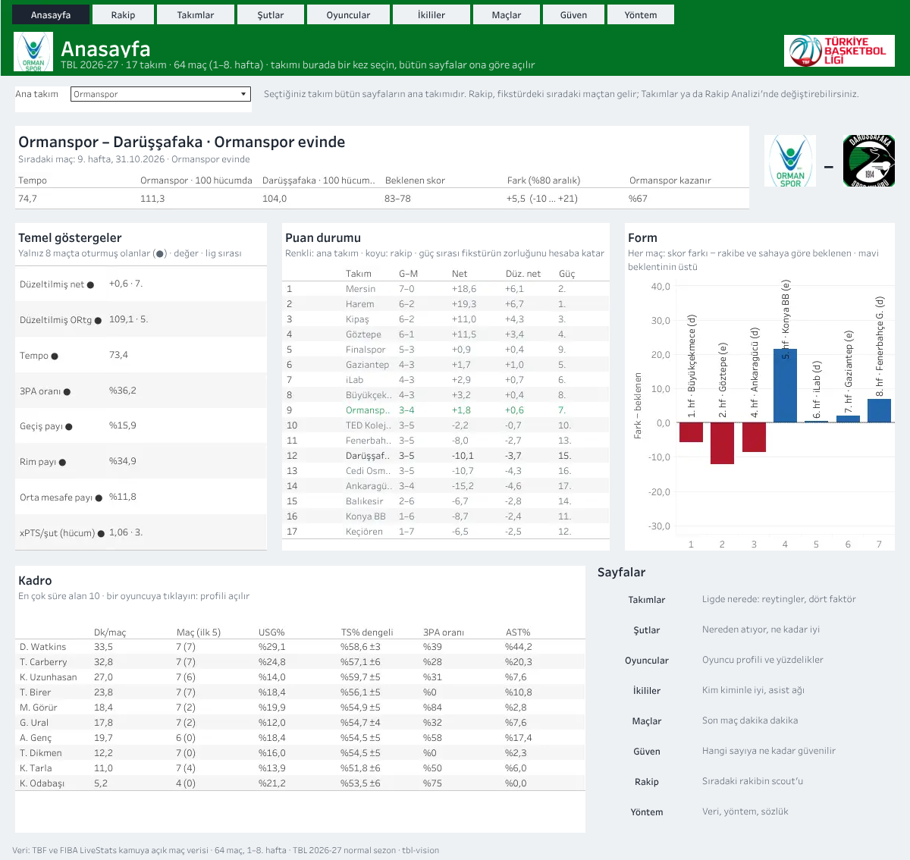
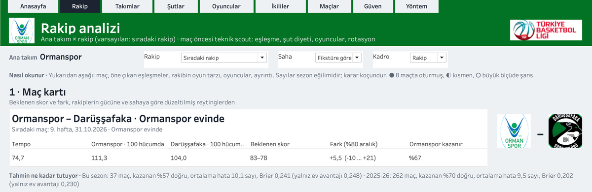

# tbl-vision

A data pipeline and scouting dashboard for the Turkish Basketball League (TBL).
It joins two public sources: TBF (the federation's API) and FIBA LiveStats
(Genius Sports). It rebuilds every game possession by possession and turns the
season into a Tableau dashboard a coach can read before a game.

- **Live dashboard:** [rberkkaratas.com/tbl-vision](https://rberkkaratas.com/tbl-vision)
  (or directly on [Tableau Public](https://public.tableau.com/views/tbl-2026-27/Anasayfa))
- **How to read the opponent page:** [blog post (EN)](https://rberkkaratas.com/en/writing/how-to-read-a-scouting-page)
  · [yazı (TR)](https://rberkkaratas.com/yazilar/rakip-sayfasi-nasil-okunur)



## What it does

```
TBF API ──────────┐                                          ┌─> analysis tables (Parquet, DuckDB)
 (fixtures, ids,  │   raw store      staged         enriched │
  officials)      ├─> (never      ─> (parsed,    ─> (order,  ├─> metrics.json
FIBA LiveStats ───┘    overwritten)   validated)     lineups, │
 (play-by-play,                                     possessions,└─> Tableau CSV + Hyper + .twb
  shots x/y, box)                                    shot zones)
```

1. **Sync.** `tbl sync` fetches only what is due: new or unsettled games and
   expired lists. Every response is stored as a compressed file and never
   overwritten.
2. **Build.** `tbl build` parses both sources and maps Genius players to TBF's
   persistent ids. It validates the two sources against each other, then
   enriches the play-by-play: canonical event order, five-man lineups on every
   event, possessions, free-throw trips and shot zones in metres.
3. **Analyse.** `tbl analyze` fits an expected-points (xPTS) shot model and
   builds team and player profiles. It also measures how many games each stat
   needs before it can be trusted, projects matchups, and writes a complete
   Tableau workbook in code.

Some of the checks the pipeline passes, measured on its own data:

- Lineups replayed from the starters give every player's minutes within 5
  seconds of the box score, in all 8,521 player-games of 2025-26 and 2026-27.
  Plus/minus from those lineups matches FIBA LiveStats in 8,459 of them.
- Fourteen box-score stats of every player are recounted from the
  play-by-play, and all of them agree with the box score.
- Possessions follow FIBA rules and Dean Oliver's definition, and in every period
  the two teams stay within one possession of each other.
- The xPTS model predicts every shot with a model fitted without that game.
  Last season's model, frozen, scores this season's 8,162 shots as well as an
  in-season model does (log loss 0.6467 vs 0.6486).
- The matchup model was tested walk-forward on 2025-26, predicting each game
  only from the games before it. It picked the winner in 70% of 262 games
  (Brier score 0.202, against 0.230 for home advantage alone).

## The dashboard

Nine pages built around one team: Home, Opponent, Teams, Shots, Players, Pairs,
Games, Reliability and Method. You choose the main team once on the home page.
The opponent page finds the next opponent from the fixture list and reads top
to bottom: a game card with an 80% range, the matchups that stand out, the
opponent's style, their key players, the full four-factor matchup, rotation
and form.



Every number carries a data-strength mark (● settled, ◐ partly, ○ mostly luck
after N games). The wording describes and never prescribes: the page shows
tendencies and leaves the decision to the coach.

## Quick start

Requires Python 3.12 and [uv](https://docs.astral.sh/uv/). Syncing TBF also
needs Google Chrome.

```bash
uv sync
uv run pytest                              # 33 tests run offline; 20 more need tests/fixtures (not in git)
uv run tbl sync --season 2025-26           # fetch a season (opens Chrome for TBF)
uv run tbl build --season 2025-26
uv run tbl analyze --season 2025-26        # analyse seasons in order: the next one uses this one
uv run tbl sync && uv run tbl build && uv run tbl analyze   # 2026-27 (default)
```

Data lives outside the repo, in `$TBL_DATA_DIR` (default `~/data/tbl`). The
workbook is written to `~/data/tbl/tableau/tbl-2026-27/tbl-2026-27.twb`; open
it in Tableau Public. See [running the pipeline](docs/for-humans/running.md).

## Documentation

The docs come in two versions written for different readers:

| | For humans | For AI agents |
|---|---|---|
| Start here | [docs/for-humans](docs/for-humans/README.md) | [docs/for-ai](docs/for-ai/README.md) |
| Style | explanations, reasons, numbers, reading order | dense rules: repo map, invariants, commands, traps |

Coding agents also find [AGENTS.md](AGENTS.md) at the root.

## Data, sources and scope

- **No match data is in this repository** and none is redistributed. TBF and FIBA
  LiveStats data belong to their owners; the pipeline reads public endpoints for
  personal, non-commercial analysis. Tests that need real responses skip when
  `tests/fixtures/` is absent.
- **Polite fetching.** Requests to TBF run 2-4 seconds apart in a real browser
  window. TBF sits behind Cloudflare; the pipeline never solves a captcha. It
  waits for a person or stops, and the next run resumes. FIBA LiveStats requests
  revalidate with ETags.
- **Logos** (club logos from FIBA LiveStats, the TBL mark from Wikipedia) are
  downloaded at run time for the dashboard and are not part of this repository.
- This project is not affiliated with TBF, the Turkish Basketball League or
  Genius Sports.

## License

The code is under the [MIT License](LICENSE). The license does not cover any
data, logos or trademarks the code may download.
