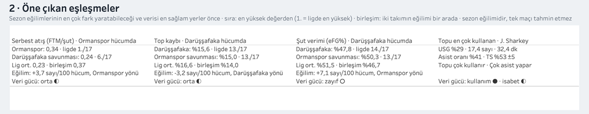
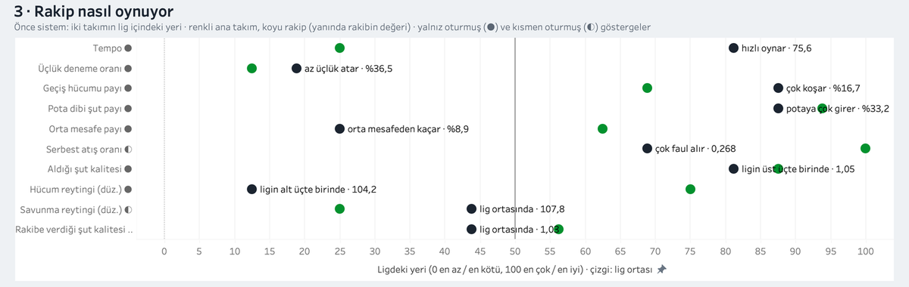

# The dashboard

The Tableau workbook is generated in code. Nobody drags fields in Tableau: every
sheet, calculated field, parameter, dashboard and click action is written as XML by
`tbl analyze`. Change the code and run it again; the workbook is rebuilt from scratch.

Published version: [Tableau Public](https://public.tableau.com/views/tbl-2026-27/Anasayfa),
embedded at [rberkkaratas.com/tbl-vision](https://rberkkaratas.com/tbl-vision). A
walk-through of the opponent page for coaches:
[How to read a scouting page](https://rberkkaratas.com/en/writing/how-to-read-a-scouting-page).

## Pages

The interface is in Turkish. Every page has the same strip on top for moving
between pages.

| Page | What it shows |
|---|---|
| Anasayfa (Home) | choose the main team once; next game card, the settled key measures, standings, form, roster, links to every page |
| Rakip Analizi (Opponent) | the scouting page, top to bottom: game card with an 80% range, standout matchups, the opponent's style, their key players, full four-factor matchup and shot diet, rotation and lineups, form and past meetings |
| Takımlar (Teams) | team ratings, four factors, efficiency by how possessions start |
| Şut Kalitesi (Shots) | shot map, players' shot quality vs shot-making, teams' shot quality taken and allowed |
| Oyuncular (Players) | player profile, league percentiles, usage vs efficiency, on/off |
| İkililer (Pairs) | two players together and apart, assist network |
| Maçlar (Games) | score margin over time, game summary, runs, comebacks, clutch |
| Güven (Reliability) | raw vs blended player values with 90% intervals, how many games each stat needs, model checks |
| Yöntem (Method) | data sources, glossary, small-sample notes |

## How it is built

| File | Role |
|---|---|
| `analysis/presentation.py` | viewer-facing tables: Turkish number formats (106,9 · %55,1), card lines, KPI strips, the `mx_*` opponent tables |
| `analysis/glossary.py` | Turkish name and definition of every metric, attached to rows for tooltips |
| `analysis/assets.py` | team logos, the TBL logo, team colours |
| `analysis/tableau.py` | writes the CSVs, Hyper extracts, court image and theme files |
| `analysis/dashboards.py` | the design: parameters, calculated fields, sheets, dashboards, actions |
| `analysis/workbook.py` | the `.twb` XML writer |

A few design choices:

- **One main team.** The `Ana takım` parameter is set once on the home page and every page
  follows it. `Rakip` defaults to "Sıradaki rakip", which resolves to the main team's next
  opponent from the fixture list. `Görünüm` switches a page between the main team and the
  opponent.
- **Clicks.** Clicking a team sets the opponent; clicking a player sets the player and
  opens the Players page (a Tableau "Go to Sheet" navigation, which leaves no filter
  behind).
- **Text is formatted before Tableau.** Tableau's `STR()` always prints a decimal point,
  so every number a viewer reads is formatted in Python and Tableau only places it.
- **Tooltips explain every metric.** Tableau shows no tooltip on a column header, so each
  row carries its metric's Turkish name and definition.
- **Team theme.** The page header takes the main team's colour, chosen from the club's kit
  colours that its logo actually carries and darkened until it reads on white (WCAG 3:1
  for marks, a darker shade under white text).
- **Logos** are Tableau custom shapes, embedded in the workbook. `tbl analyze` also copies
  them to `~/Documents/My Tableau Repository/Shapes/TBL Logolar` for Tableau Desktop.
- **Fixed size.** Every page is 1200 × 1134 px, so switching pages does not shift the
  layout. The opponent page is taller and scrolls.
- **No verdicts.** Cards describe numbers with their league context and data strength;
  see [methods.md](methods.md#7-wording).

## Open and publish

1. Run `uv run tbl analyze` (seasons in order; see [running.md](running.md)).
2. Open `~/data/tbl/tableau/tbl-2026-27/tbl-2026-27.twb` in Tableau Public (Desktop
   Public Edition). All data sources are Hyper extracts, so nothing needs reconnecting.
3. **File → Save to Tableau Public As…**. On the workbook's page on Tableau Public, turn
   off "Allow access" to downloads and keep "Show sheets as tabs" off: the page strip
   handles navigation.

Anything saved to Tableau Public, including the extracts, is public. Do not treat the data
in a published workbook as private.

## Changing it

- Edit `dashboards.py` (or `presentation.py` for the text), run `uv run tbl analyze`, and
  reopen the workbook. Tableau validates the XML on open and shows an error naming the
  element it rejects.
- `tests/test_analysis.py` checks the workbook structure (sheet and dashboard counts,
  action order, no sheet used twice on one dashboard).
- The rules for writing valid workbook XML, learned by trial against Tableau Public
  2026.3, are collected in [../for-ai/tableau-xml.md](../for-ai/tableau-xml.md).
